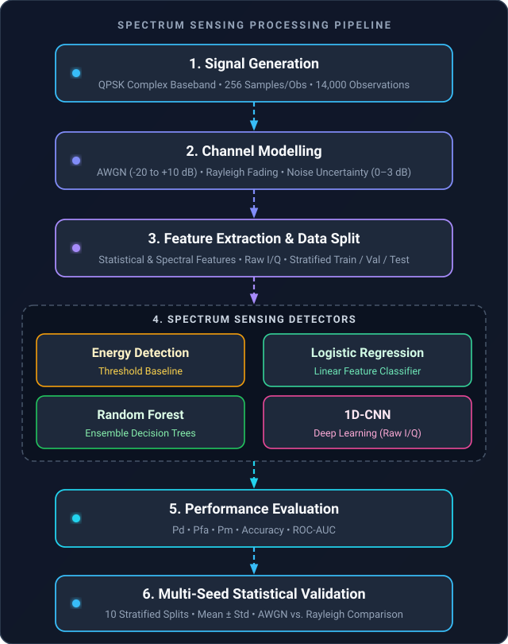
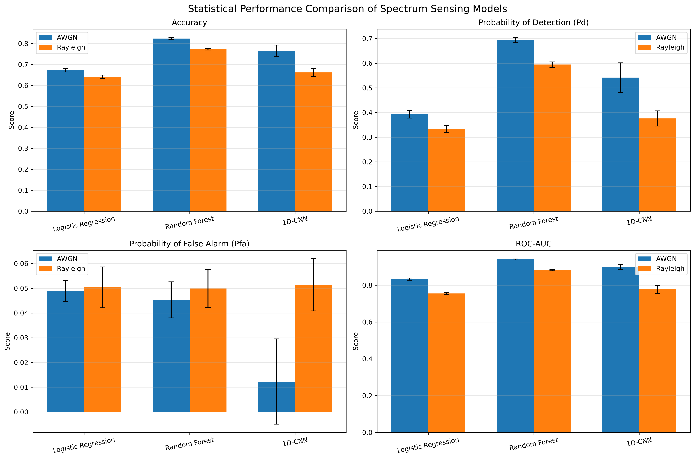
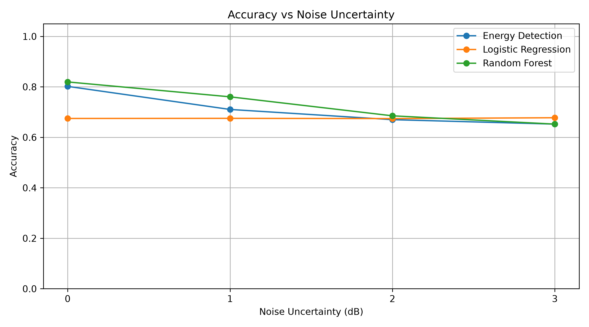

<div align="center">

# ML-Based Intelligent Spectrum Sensing for Cognitive Radio Networks

**Primary-User Detection Under Low-SNR, Noise-Uncertainty, and Rayleigh Fading Conditions**

[](https://www.python.org/)
[](https://www.tensorflow.org/)
[](https://scikit-learn.org/)
[](https://jupyter.org/)
[](https://git-lfs.com/)

[Overview](#overview) · [Architecture](#system-architecture) · [Results](#experimental-results) · [Noise Uncertainty](#noise-uncertainty-analysis) · [Setup](#installation--setup) · [Notebooks](#notebook-workflow)

</div>

---

## Overview

Cognitive Radio Networks (CRNs) allow secondary users to opportunistically access underutilized spectrum bands without interfering with licensed primary users. A core requirement is **spectrum sensing**—reliably determining whether a primary user is transmitting in a given band.

Conventional **Energy Detection (ED)** degrades significantly under low signal-to-noise ratio (SNR) and noise uncertainty. This repository presents a controlled, synthetic-data-based experimental study comparing classical machine learning and deep learning detectors against conventional Energy Detection across **AWGN** and **Rayleigh fading** channels.

### Implemented Detectors

- **Energy Detection (ED):** Conventional threshold-based baseline comparing received signal energy against a calibrated threshold.
- **Logistic Regression (LR):** Linear supervised classifier trained on extracted statistical and spectral features.
- **Random Forest (RF):** Ensemble decision-tree classifier trained on extracted statistical and spectral features.
- **1D Convolutional Neural Network (1D-CNN):** Deep-learning model operating directly on raw in-phase and quadrature (I/Q) samples using convolutional layers, max pooling, global average pooling, a dense layer, and a sigmoid output.

---

## System Architecture

<p align="center">
  
</p>

---

## Signal & Dataset Configuration

All experiments use synthetically generated complex-valued communication signals for controlled algorithm evaluation.

| Parameter | Configuration |
| :--- | :--- |
| **Modulation** | QPSK |
| **Samples / Observation** | 256 |
| **SNR Range** | `-20 dB` to `+10 dB` (`5 dB` steps, 7 levels) |
| **Samples / Class / SNR** | 1,000 |
| **Total Observations** | 14,000 |
| **Channel Models** | AWGN and Rayleigh flat fading |
| **Classes** | **H0 (`0`):** Primary user absent (noise only)<br>**H1 (`1`):** Primary user present (signal + noise) |

<details>
<summary><strong>Generated Dataset Files (Git LFS)</strong></summary>

- `spectrum_sensing_dataset.npz` — Raw AWGN I/Q observations
- `spectrum_sensing_features.csv` / `spectrum_sensing_features.npz` — Extracted AWGN features
- `rayleigh_fading_dataset.npz` — Raw Rayleigh fading I/Q observations
- `rayleigh_fading_features.npz` — Extracted Rayleigh fading features
- `noise_uncertainty_0dB.npz` … `noise_uncertainty_3dB.npz` — Noise-uncertainty evaluation sets

</details>

---

## Experimental Results

Models are evaluated using **Accuracy**, **Probability of Detection (P<sub>d</sub>)**, **Probability of False Alarm (P<sub>fa</sub>)**, **Probability of Miss (P<sub>m</sub>)**, and **ROC-AUC**.

The tables below report **mean ± standard deviation** across **10 stratified train-validation-test splits** of the same synthetic dataset.

### AWGN Channel

| Model | Accuracy | P<sub>d</sub> | P<sub>fa</sub> | ROC-AUC |
| :--- | :---: | :---: | :---: | :---: |
| **Logistic Regression** | 67.21 ± 0.77% | 39.32 ± 1.59% | 4.90 ± 0.42% | 0.8330 ± 0.0058 |
| **Random Forest** | **82.40 ± 0.40%** | **69.34 ± 1.02%** | 4.53 ± 0.73% | **0.9400 ± 0.0027** |
| **1D-CNN** | 76.48 ± 2.79% | 54.19 ± 5.97% | 1.23 ± 1.72% | 0.8979 ± 0.0132 |

### Rayleigh Fading Channel

| Model | Accuracy | P<sub>d</sub> | P<sub>fa</sub> | ROC-AUC |
| :--- | :---: | :---: | :---: | :---: |
| **Logistic Regression** | 64.18 ± 0.75% | 33.39 ± 1.43% | 5.04 ± 0.82% | 0.7550 ± 0.0060 |
| **Random Forest** | **77.23 ± 0.34%** | **59.45 ± 1.10%** | 4.99 ± 0.76% | **0.8819 ± 0.0031** |
| **1D-CNN** | 66.23 ± 1.84% | 37.60 ± 3.08% | 5.14 ± 1.06% | 0.7769 ± 0.0220 |



> [!NOTE]
> Standard deviations reflect split-level variation across 10 different stratified splits of the same fixed synthetic dataset rather than 10 independently generated datasets.

### Key Findings

- **Random Forest** achieved the strongest overall performance across both AWGN (`0.9400` ROC-AUC) and Rayleigh fading (`0.8819` ROC-AUC).
- **1D-CNN** delivered competitive ROC-AUC under AWGN (`0.8979`), operating with a lower false-alarm rate (`1.23%`) than the nominal `5%` target and a correspondingly lower P<sub>d</sub>.
- **Rayleigh fading** degraded detection performance across all evaluated ML models compared to AWGN.
- **Logistic Regression** showed the lowest overall detection capability among the ML models.

---

## Noise Uncertainty Analysis

Robustness was evaluated across noise uncertainty levels of **0 dB, 1 dB, 2 dB, and 3 dB** (each level using a newly generated dataset, so measurements are not paired across identical test observations).

- **Energy Detection** is particularly sensitive to increasing noise uncertainty.
- **Random Forest** also degrades as noise uncertainty rises, though starting from a higher baseline.
- **Logistic Regression** exhibits comparatively smaller accuracy changes across the tested uncertainty range.

<details>
<summary><strong>View Accuracy vs. Noise Uncertainty Plot</strong></summary>



</details>

---

## Installation & Setup

### Prerequisites

- **Python 3.12**
- **Git** & **Git LFS**
- **Jupyter Notebook** (or **VS Code** with the Jupyter extension)

### Quick Start

1. **Clone the repository and pull LFS assets**

   ```bash
   git clone https://github.com/tejassinghsandhu/ml-based-spectrum-sensing-cognitive-radio.git
   cd ml-based-spectrum-sensing-cognitive-radio
   git lfs install
   git lfs pull
   ```

2. **Create and activate a virtual environment**

   - **Windows (PowerShell):**
     ```powershell
     python -m venv .venv
     .venv\Scripts\activate
     ```
   - **Linux / macOS:**
     ```bash
     python3 -m venv .venv
     source .venv/bin/activate
     ```

3. **Install dependencies**

   ```bash
   pip install -r requirements.txt
   ```

---

## Notebook Workflow

Launch Jupyter Notebook (`jupyter notebook`) or open the folder in VS Code and run the notebooks in numerical order, as later experiments rely on datasets and trained models saved by earlier steps.

<details>
<summary><strong>Execution Order (Notebooks 01 – 14)</strong></summary>

| Step | Notebook | Purpose |
| :---: | :--- | :--- |
| 1 | `01_signal_generation.ipynb` | Base QPSK signal generation |
| 2 | `02_awgn_channel.ipynb` | AWGN channel modelling & Energy Detection baseline |
| 3 | `03_rayleigh_fading.ipynb` | Rayleigh flat-fading channel modelling |
| 4 | `04_dataset_generation.ipynb` | Full multi-SNR dataset generation |
| 5 | `05_feature_extraction.ipynb` | Statistical & spectral feature extraction |
| 6 | `06_dataset_preparation.ipynb` | Train / validation / test splitting |
| 7 | `07_logistic_regression.ipynb` | Logistic Regression training & evaluation |
| 8 | `08_random_forest.ipynb` | Random Forest training & evaluation |
| 9 | `09_model_comparison.ipynb` | Baseline & ML model comparison |
| 10 | `10_noise_uncertainty.ipynb` | Noise uncertainty robustness (`0–3 dB`) |
| 11 | `11_rayleigh_robustness.ipynb` | Rayleigh fading robustness & cross-channel tests |
| 12 | `12_statistical_validation.ipynb` | 10-split statistical validation (LR & RF) |
| 13 | `13_1d_cnn.ipynb` | 1D-CNN training on raw I/Q samples |
| 14 | `14_cnn_statistical_validation.ipynb` | 10-split statistical validation (1D-CNN) |

</details>

<details>
<summary><strong>Repository Layout</strong></summary>

```text
Cognitive_Radio_ML/
├── src/
│   └── signal_generation.py
├── 01_signal_generation.ipynb ... 14_cnn_statistical_validation.ipynb
├── *.npz / *.csv              # Generated datasets & evaluation summaries
├── *.pkl / *.keras / *.npy    # Saved models, scalers & thresholds
├── *.png                      # Generated performance plots
├── .gitattributes
├── .gitignore
├── README.md
└── requirements.txt
```

*Note: Experiment notebooks, datasets, saved models, and generated plots are stored directly in the repository root alongside `src/`.*

</details>

---

## Limitations & Future Scope

> [!IMPORTANT]
> **Current Scope:** Experiments rely on synthetic QPSK signals and block flat Rayleigh fading rather than over-the-air RF captures, and multi-seed validation measures split-level repeatability on a fixed dataset.

**Potential Extensions:**
- Evaluate on real-world RF datasets and software-defined radio (SDR) hardware platforms.
- Extend signal generation beyond QPSK to BPSK, 16-QAM, and additional modulation schemes.
- Investigate frequency-selective multipath fading and adaptive threshold estimation under unknown noise.
- Benchmark additional deep-learning architectures for real-time spectrum sensing.

---

## Tech Stack & Author

**Built with:** Python 3.12 · NumPy · Pandas · SciPy · scikit-learn · TensorFlow / Keras · Matplotlib · Seaborn · Jupyter · Git LFS

**Author:** **Tejas Singh Sandhu** — [GitHub Profile](https://github.com/tejassinghsandhu) · [Project Repository](https://github.com/tejassinghsandhu/ml-based-spectrum-sensing-cognitive-radio)
