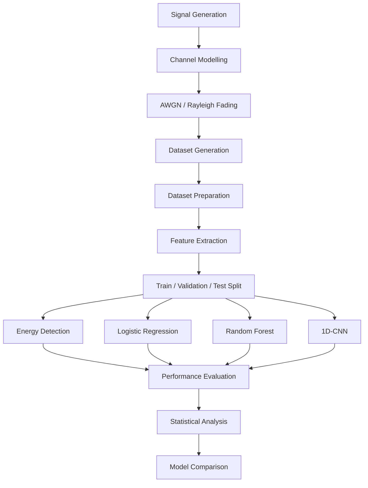

# ML-Based Intelligent Spectrum Sensing for Cognitive Radio Networks

### Under Low-SNR and Noise-Uncertainty Conditions

A machine-learning-based spectrum sensing project for Cognitive Radio Networks (CRNs), investigating primary-user detection under low signal-to-noise ratio (SNR), noise uncertainty and fading-channel conditions.

---

## 1. Project Overview

Cognitive Radio Networks enable secondary users to utilise available spectrum resources without interfering with licensed primary users.

An important requirement is **spectrum sensing**: determining whether a primary user is transmitting in a particular frequency band.

Conventional Energy Detection (ED) can experience performance degradation under low-SNR conditions and noise uncertainty.

This project investigates machine-learning-based spectrum sensing using:

- Logistic Regression (LR)
- Random Forest (RF)
- One-Dimensional Convolutional Neural Network (1D-CNN)
- Conventional Energy Detection (ED) as a baseline

The models are evaluated under Additive White Gaussian Noise (AWGN) and Rayleigh fading conditions.

## 2. Project Objectives

1. Develop a synthetic signal-generation framework for spectrum sensing.
2. Generate primary-user-present and primary-user-absent observations.
3. Extract statistical and spectral features from received signals.
4. Implement and evaluate conventional Energy Detection.
5. Develop machine-learning-based spectrum sensing models.
6. Investigate performance across different SNR levels.
7. Analyse robustness under noise uncertainty.
8. Evaluate model performance under Rayleigh fading.
9. Perform multi-seed statistical validation.
10. Compare detection performance using standard spectrum-sensing metrics.

## 3. System Architecture

The project follows this processing pipeline:



## 4. Signal and Dataset Configuration

The experiments use synthetically generated complex-valued communication signals.

| Parameter | Configuration |
|---|---|
| Signal modulation | QPSK |
| Samples per observation | 256 |
| SNR range | -20 dB to +10 dB |
| SNR increments | 5 dB |
| SNR conditions | 7 |
| Samples per class per SNR | 1,000 |
| Total observations | 14,000 |
| Channel models | AWGN and Rayleigh fading |

### Spectrum occupancy classes

- **H0 (Label 0):** Primary user absent; noise-only observation.
- **H1 (Label 1):** Primary user present; signal-plus-noise observation.

The generated datasets are synthetic and are intended for controlled algorithm evaluation.

### Dataset files

- `spectrum_sensing_dataset.npz`
- `spectrum_sensing_features.csv`
- `spectrum_sensing_features.npz`
- `rayleigh_fading_dataset.npz`
- `rayleigh_fading_features.npz`

## 5. Implemented Detection Techniques

### Energy Detection

Conventional energy detection is implemented as a baseline spectrum-sensing technique. Detection decisions are made by comparing received signal energy against a calibrated threshold.

### Logistic Regression

A supervised machine-learning classifier using extracted statistical and spectral features.

### Random Forest

An ensemble learning classifier using multiple decision trees to distinguish between occupied and vacant spectrum observations.

### 1D Convolutional Neural Network

A deep-learning model that processes raw in-phase and quadrature (I/Q) signal samples.

The CNN uses convolutional layers, max pooling, global average pooling, a dense layer and sigmoid output for binary classification.

## 6. Performance Evaluation Metrics

The following metrics are used:

| Metric | Description |
|---|---|
| Probability of Detection (Pd) | Correct detection of an active primary user |
| Probability of False Alarm (Pfa) | Incorrect detection when the primary user is absent |
| Probability of Miss (Pm) | Failure to detect an active primary user |
| Accuracy | Overall classification correctness |
| ROC-AUC | Area under the Receiver Operating Characteristic curve |

The experiments also investigate noise uncertainty and cross-channel generalisation.

## 7. Experimental Results

The following results represent mean ± standard deviation across ten different stratified train-validation-test splits of the same synthetic dataset.

### AWGN Channel

| Model | Accuracy | Pd | Pfa | ROC-AUC |
|---|---:|---:|---:|---:|
| Logistic Regression | 67.21 ± 0.77% | 39.32 ± 1.59% | 4.90 ± 0.42% | 0.8330 ± 0.0058 |
| Random Forest | 82.40 ± 0.40% | 69.34 ± 1.02% | 4.53 ± 0.73% | 0.9400 ± 0.0027 |
| 1D-CNN | 76.48 ± 2.79% | 54.19 ± 5.97% | 1.23 ± 1.72% | 0.8979 ± 0.0132 |

### Rayleigh Fading Channel

| Model | Accuracy | Pd | Pfa | ROC-AUC |
|---|---:|---:|---:|---:|
| Logistic Regression | 64.18 ± 0.75% | 33.39 ± 1.43% | 5.04 ± 0.82% | 0.7550 ± 0.0060 |
| Random Forest | 77.23 ± 0.34% | 59.45 ± 1.10% | 4.99 ± 0.76% | 0.8819 ± 0.0031 |
| 1D-CNN | 66.23 ± 1.84% | 37.60 ± 3.08% | 5.14 ± 1.06% | 0.7769 ± 0.0220 |

*Note: Standard deviations are calculated across ten runs. These runs use different splits of the same fixed synthetic dataset, not independently generated datasets.*

### Key Observations

- Random Forest achieved the strongest overall performance among the evaluated machine-learning models in both channel conditions.
- The 1D-CNN demonstrated competitive ROC-AUC under AWGN conditions.
- Performance degraded under Rayleigh fading for all three machine-learning models.
- Logistic Regression showed the weakest overall detection performance.
- The CNN's AWGN false-alarm rate was lower than the nominal 5% target, accompanied by a lower detection probability.

## 8. Noise Uncertainty Analysis

Noise uncertainty was investigated using uncertainty levels of:

- 0 dB
- 1 dB
- 2 dB
- 3 dB

The experiment evaluates how changes in actual noise power affect detection performance.

The results indicate that conventional Energy Detection is particularly sensitive to increasing noise uncertainty. Random Forest also experiences degradation, while Logistic Regression exhibits comparatively smaller changes in its measured accuracy.

Each uncertainty level uses a newly generated dataset, so these results are not paired measurements on identical test observations.

## 9. Repository Structure

```text
Cognitive_Radio_ML/
│
├── notebooks/
│   └── Jupyter experiment notebooks
│
├── src/
│   └── signal_generation.py
│
├── datasets/
│   └── Generated datasets
│
├── results/
│   ├── CSV performance tables
│   └── Experimental plots
│
├── 01_signal_generation.ipynb
├── 02_awgn_channel.ipynb
├── 03_rayleigh_fading.ipynb
├── 04_dataset_generation.ipynb
├── 05_feature_extraction.ipynb
├── 06_dataset_preparation.ipynb
├── 07_logistic_regression.ipynb
├── 08_random_forest.ipynb
├── 09_model_comparison.ipynb
├── 10_noise_uncertainty.ipynb
├── 11_rayleigh_robustness.ipynb
├── 12_statistical_validation.ipynb
├── 13_1d_cnn.ipynb
├── 14_cnn_statistical_validation.ipynb
│
├── .gitignore
├── .gitattributes
├── README.md
└── requirements.txt
```

*The directory tree above is a logical overview; the currently uploaded experiment notebooks and result files are stored in the repository root.*

## 10. Installation and Setup

### Prerequisites

- Python 3.12
- Git
- Git LFS
- Visual Studio Code (recommended)
- Jupyter Notebook support

### Clone the repository

```bash
git clone https://github.com/tejassinghsandhu/ml-based-spectrum-sensing-cognitive-radio.git
```

```bash
cd ml-based-spectrum-sensing-cognitive-radio
```

### Create a virtual environment

Windows:

```powershell
python -m venv .venv
.venv\Scripts\activate
```

Linux/macOS:

```bash
python3 -m venv .venv
source .venv/bin/activate
```

### Install dependencies

```bash
pip install -r requirements.txt
```

### Download Git LFS files

```bash
git lfs install
git lfs pull
```

## 11. Running the Experiments

Launch Jupyter Notebook:

```bash
jupyter notebook
```

Or open the repository in Visual Studio Code and execute the notebooks individually.

Recommended execution order:

1. Signal generation
2. AWGN channel modelling
3. Rayleigh fading
4. Dataset generation
5. Feature extraction
6. Dataset preparation
7. Logistic Regression
8. Random Forest
9. Model comparison
10. Noise uncertainty
11. Rayleigh robustness
12. Statistical validation
13. 1D-CNN
14. CNN statistical validation

Execute the notebooks in the recommended order when reproducing the complete workflow, since later experiments may depend on previously generated datasets and saved model files.

## 12. Limitations

- The project uses synthetic communication signals rather than real-world RF measurements.
- The primary signal generator currently uses QPSK.
- The Rayleigh channel implementation uses block flat fading.
- The experiments do not establish generalisation to all modulation schemes, hardware platforms or real wireless environments.
- Multi-seed results represent split-level repeatability on a fixed dataset rather than independent experimental replication.

## 13. Future Scope

Potential extensions include:

- Evaluation using real-world RF datasets.
- Support for BPSK, QPSK, 16-QAM and other modulation schemes.
- Investigation of frequency-selective multipath fading.
- Adaptive threshold estimation under unknown noise conditions.
- Evaluation of additional deep-learning architectures.
- Hardware implementation and real-time spectrum sensing.
- Testing on software-defined radio platforms.

## 14. Technologies Used

- Python
- NumPy
- Pandas
- SciPy
- Scikit-learn
- TensorFlow / Keras
- Matplotlib
- Jupyter Notebook
- Git and Git LFS

## 15. Author

**Tejas Singh Sandhu**

GitHub: [tejassinghsandhu](https://github.com/tejassinghsandhu)

Project repository:

[ML-Based Intelligent Spectrum Sensing for Cognitive Radio Networks](https://github.com/tejassinghsandhu/ml-based-spectrum-sensing-cognitive-radio)

---

*This repository presents a synthetic-data-based experimental study of machine-learning approaches for spectrum sensing in cognitive radio networks.*
